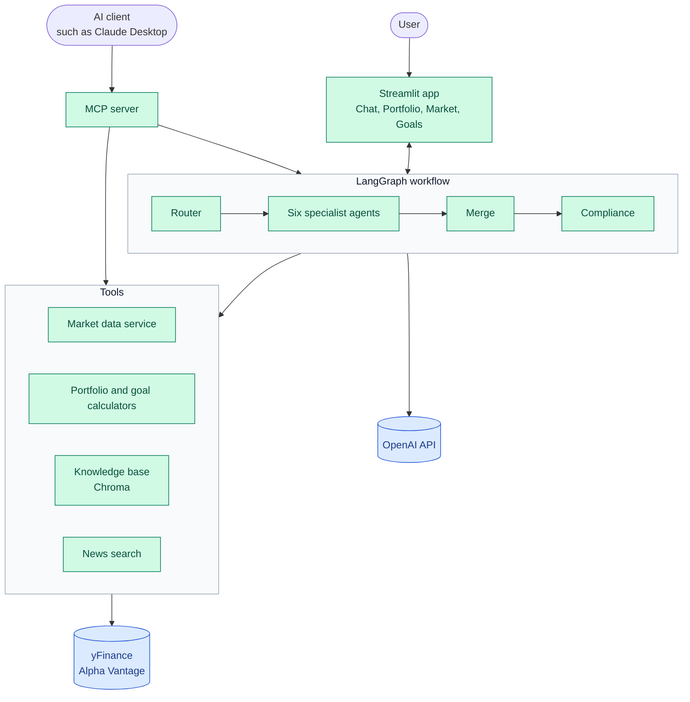
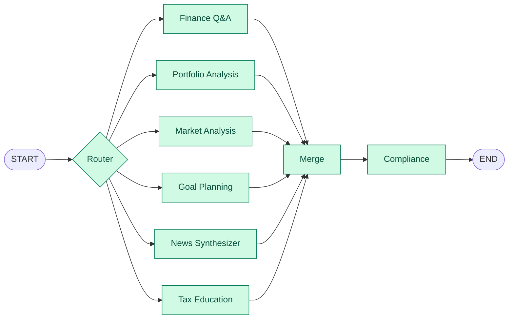
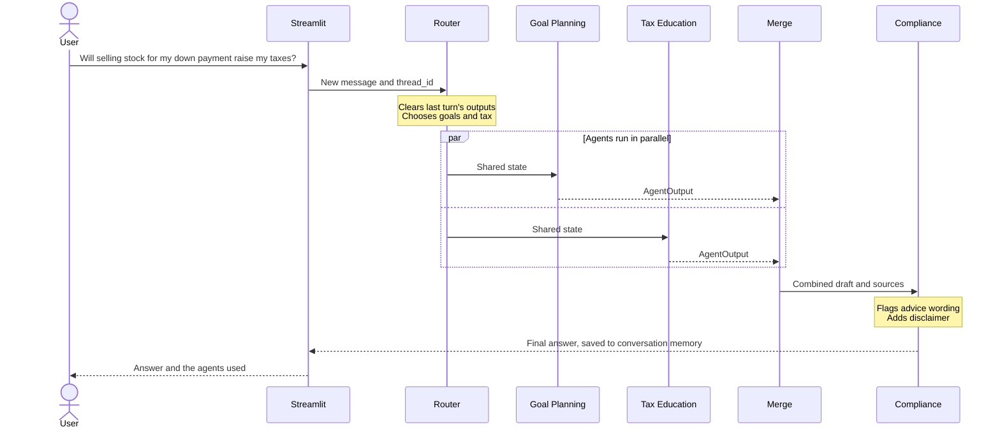
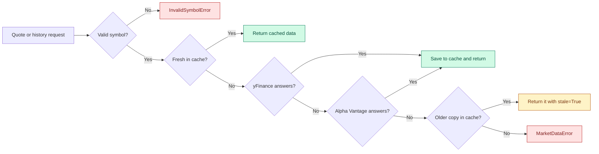
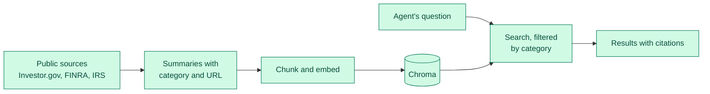

# Technical Design: AI Finance Assistant

Living document. It describes both what exists and what is planned, and the status below shows which is which.

## Scope
Education for US beginners, not personalized advice. Tax content covers US rules only.

## Build status
| Part | Status |
|---|---|
| LangGraph workflow, router, memory, compliance | Built |
| Market data layer | Built; Alpha Vantage tested only against simulated responses |
| Streamlit app | Chat and dashboard tabs built |
| Six agents | Built and tested with live data |
| Portfolio metrics, goal projections | Built and used by the agents and dashboards |
| Knowledge base and search | Built with 71 articles and used by the agents |
| Portfolio, Market, and Goals dashboards | Built |
| Arize tracing | Built; traces confirmed in Arize |
| End-to-end evals, metrics, and user feedback | Built; results in `docs/EVAL_RESULTS.md` |
| User accounts and saved conversations (SQLite) | Built |
| MCP server | Built; tested over stdio with live data |
| Docker | Written; not yet built, because Docker isn't installed on the dev machine |

## System overview

**Key:** green is built and blue is an external service. Only the market data service uses yFinance and Alpha Vantage.

## Stack
| Concern | Choice | Why |
|---|---|---|
| Orchestration and state | LangGraph | Named in the rubric; explicit graph, parallel branches, built-in memory |
| LLM | OpenAI, set in `config.yaml` | Key available; created in one file (`src/core/llm.py`) |
| Vector store | Chroma | Runs locally with metadata filtering for categories |
| Market data | yFinance, Alpha Vantage fallback | Free primary source plus a backup |
| UI | Streamlit | Named in the rubric; quick multi-tab app |

## Workflow
This graph matches `src/workflow/graph.py`. The router can select any combination of agents, and those agents run in parallel.


- **Router:** the LLM picks one or more agents using structured output. Keyword rules take over if there is no key or the call fails.
- **Agents:** each takes state and returns one `AgentOutput`.
- **Merge:** combines outputs in a fixed order and de-duplicates sources.
- **Compliance:** adds a disclaimer and flags advice-like wording.

## One question, start to finish
This example follows a question that spans two agents.



## Agent communication
Agents do not call each other. They communicate only through shared state (`src/core/state.py`), which keeps them independently testable. Results are combined by the `collect_outputs` reducer; the router clears it each turn so old answers do not leak into the next one.

## Agents
| Agent | Gets facts from | Without an LLM |
|---|---|---|
| Finance Q&A | Knowledge base, all categories | Shows the retrieved text |
| Tax Education | Knowledge base, tax category | Shows the retrieved text |
| Portfolio Analysis | Market data and portfolio metrics | Shows metrics for holdings entered in the Portfolio tab; asks otherwise |
| Market Analysis | Market data | Shows an index overview |
| Goal Planning | Goal projections | Asks for details |
| News Synthesizer | Yahoo headlines | Searches the message text and lists matching headlines |

News has no separate backup provider because Alpha Vantage's news feed is premium-only. Headlines that don't mention a requested company are dropped.

## Key decisions
1. **Code calculates, the LLM explains.** Financial figures come from tested Python. Prompts alone did not hold in live testing, so `explain` in `src/agents/common.py` also rejects any answer containing a dollar amount, percentage, or year absent from its source data and the user's message, and shows the verified facts instead. It does not check other claims in the wording, which is what the planned evals cover.
2. **Failures stay contained.** A failing agent yields an error output, and other agents still answer.
3. **Conversation memory is per thread.** The app saves it to SQLite with `SqliteSaver`, so it survives restarts. Tests and evals use `InMemorySaver` (see below).
4. **Compliance is enforced by the graph,** so no agent can skip it.
5. **Rules that must hold are enforced in code** (see [GUARDRAILS.md](GUARDRAILS.md)). Evals showed the model can ignore prompt rules, and an LLM judge can miss it. So the market agent adds the prediction refusal in code, and the summary linking several agents' sections is dropped if it contains any figures.

## Market data

Quotes stay fresh for 60 seconds and history for an hour. A rate-limited provider is skipped for a cooldown period. The free Alpha Vantage series covers about 100 trading days, so long-range requests served by the fallback come back shorter.

## Portfolio metrics
`src/utils/portfolio_metrics.py` calculates value, weights, gains, effective number of holdings, volatility, max drawdown, Sharpe ratio, and beta against the S&P 500. Risk metrics apply today's weights to past daily returns, so they describe the current mix rather than the user's actual results. Returns are not annualized below 200 trading days. The metrics can't see inside funds, so a broad ETF counts as one holding and observations word concentration accordingly. Holdings' returns include dividends while the S&P 500 index does not, which slightly flatters comparisons against it. Observations state facts and never say what to do. Missing prices or history are reported, not hidden.

## Goal projections
`src/utils/goal_projections.py` gives a straight-line estimate and a seeded Monte Carlo simulation of monthly lognormal returns. Targets grow with inflation, and contributions stay flat. Return and volatility assumptions are illustrative values in `config.yaml`, and taxes and fees are ignored.

## Dashboards
The Portfolio, Market, and Goals tabs use the same calculation code as the agents, drawn with Plotly in `src/web_app/charts.py`.

| Tab | Shows |
|---|---|
| Portfolio | Holdings editor saved per user, value and gain, allocation, $100 in today's mix vs the S&P 500, risk figures, positions table |
| Market | S&P 500, Dow, and Nasdaq with the day's change, plus a price chart for any ticker over 1 to 12 months |
| Goals | Chance of reaching a goal, a fan chart of the middle outcome and the range 8 in 10 simulations fell within, and the same goal at each risk level |

- **Holdings and chat:** holdings typed in a question win, so "what if I owned 10 AAPL?" works. Otherwise the Portfolio agent uses the saved holdings. This costs one extraction call even when saved holdings exist.
- **Colors:** a colorblind-checked palette, blue for the main series and orange for the comparison, with direct labels so identity doesn't rely on color. Streamlit's theme handles light and dark mode.
- **Cost of live data:** Streamlit runs every tab on each interaction, so the Market tab fetches quotes then. The 60-second cache limits this to about a second, once a minute.

## MCP server
`src/mcp_server/server.py` exposes the assistant to any MCP client, such as Claude Desktop, over stdio. Run it with `python -m src.mcp_server.server`.

| Tool | Uses | LLM call |
|---|---|---|
| `get_quote`, `market_overview` | Market data service, up to 10 symbols | No |
| `get_price_history` | Market data service; returns a summary, not every close | No |
| `analyze_portfolio` | Portfolio metrics | No |
| `project_goal` | Goal projections | No |
| `search_knowledge_base` | Chroma, with the same 0.3 cutoff as the agents | Embeddings only |
| `search_news` | News service | No |
| `ask_finance_assistant` | The whole LangGraph workflow, including compliance | Yes |

- **Code calculates, the client explains.** Most tools return data, and the client's model writes the answer. Those tools skip the app's figure check and compliance step, so they return a disclaimer and the server's instructions ask the client not to give advice or predictions. `ask_finance_assistant` keeps every guardrail.
- **No accounts.** The server reads no saved users, holdings, or conversations. Each `ask_finance_assistant` call is a new conversation.
- **Input limits.** Questions are capped at 2,000 characters, symbols at 10, and holdings at 50. Invalid input comes back as a tool error.
- **Clean output.** Numbers are rounded to 2 decimals, and dates are ISO text. Logs and the Arize banner go to stderr, since stdout carries the protocol.

## Docker
The `Dockerfile` builds one image for both the app and the MCP server.

- **Data:** the database, search index, and feedback file live in the `/app/data` volume, so they survive restarts.
- **Index:** built on first start, which calls OpenAI embeddings. A marker file is written only after a full build, so a failed build is retried.
- **Secrets:** keys come from `.env` at run time and are never copied into the image. `.dockerignore` also excludes local data.
- **User:** runs as a non-root user.

Not yet verified: Docker isn't installed on the dev machine, so the image hasn't been built.

## Accounts and saved conversations
Users create an account, log in, and return to their earlier conversations and profile. All data stays in one local SQLite file, which is excluded from Git and readable only by its owner.

```mermaid
flowchart LR
    login["Sign up or log in"] --> users[("users<br/>password hash, profile")]
    login --> list["Choose or start<br/>a conversation"]
    list --> threads[("threads and turns<br/>ownership and chat history")]
    list --> graph["LangGraph workflow"]
    graph <--> checkpoints[("checkpoints<br/>conversation state")]
```

- **Passwords:** stored only as salted `scrypt` hashes from Python's standard library, never as plain text. Login errors and timing don't reveal whether an email exists, though sign-up does say when an email is taken.
- **Conversations:** LangGraph's `SqliteSaver` holds what the agents remember. A `turns` table holds what the UI shows, including sources, agents, and ratings. Deleting a conversation clears both.
- **Access control:** a `threads` table records each conversation's owner, and the app checks ownership before loading one. Every thread query filters by user, so a thread ID alone grants nothing.
- **Profile:** knowledge level and risk tolerance are saved per user and passed into graph state.
- **Limits:** the prototype has no email verification, password reset, login rate limit, or account deletion, and data is not encrypted at rest, so it is not suitable for real financial data as is. Logging in again after a page refresh is expected, though saved conversations remain. Moving to multiple servers would need a shared database such as Postgres.

## RAG
71 articles summarize public pages from Investor.gov, FINRA, and the IRS in `src/data/knowledge_base/`. Each is tagged with one of six categories, its source URL, and its retrieval date. Indexing fails if an article has no source on those domains.

- **Chunking:** split at `##` headings, then paragraphs and sentences, up to 900 characters with 120 overlapping. Each chunk starts with its article title and section. The result is 108 chunks.
- **Embedding:** OpenAI `text-embedding-3-small`.
- **Storage:** local Chroma with cosine distance, rebuilt in full by `python -m src.rag.build_index`.
- **Search:** top 4 chunks, optionally filtered by category, dropping scores below 0.3.

**Accuracy:** tax amounts carry their tax year and need refreshing each year. Every figure was checked against the saved text of its source page, which confirms the numbers appear there but not that each is used correctly.



## Observability
**Arize AX** is the chosen tracing and evaluation platform, using its hosted service, so nothing extra runs locally or on AWS. `src/utils/tracing.py` connects it using OpenInference, an OpenTelemetry-based standard. Each request becomes a trace made of spans for the router, each agent, and LLM calls.

Tracing is off unless `ARIZE_TRACING=true`, and it must start before LangChain is imported. A tracing failure logs a warning and never stops the app. Traces send prompts to a third party, including anything users type and portfolio details, so tracing is for development with made-up data.

## Metrics
See [METRICS.md](METRICS.md) for the complete list and what each metric means.

**On every trace:** route and how it was chosen, each agent's errors and citation count, retrieval result count and top score, market data provider and cache hits, and compliance flags. Custom spans cover knowledge search, market data, news search, portfolio metrics, and goal simulations. They attach to LangChain's active span, because its instrumentor does not set OpenTelemetry's current span. Traces are grouped into sessions by conversation.

**Event counts** (`src/utils/metrics.py`): rejected answers, routing fallbacks, failed extractions and explanations, empty retrievals, market provider fallbacks, stale prices, agent exceptions, and compliance flags.

**User feedback:** thumbs up or down in the chat, saved to a local `feedback.jsonl` with no conversation text.

**Evals** (`python -m src.workflow.evaluate`): routing, faithfulness, relevance, advice safety, out-of-scope handling, latency, LLM calls, cost, and token-limit cutoffs. Judge failures are reviewed by hand, because the judge can be wrong.

## Performance
Retrieval, measured by `python -m src.rag.evaluate` on 40 labeled questions and 5 off-topic ones:

| Metric | Result |
|---|---|
| Correct article ranked first | 100% |
| Lowest score for a correct article | 0.33 |
| Highest off-topic score | 0.21 |
| Median search time, including the embedding call | About 210 ms |

These are optimistic: the questions were written by the author of the articles, so they are not an independent test. End-to-end results are in [EVAL_RESULTS.md](EVAL_RESULTS.md).
