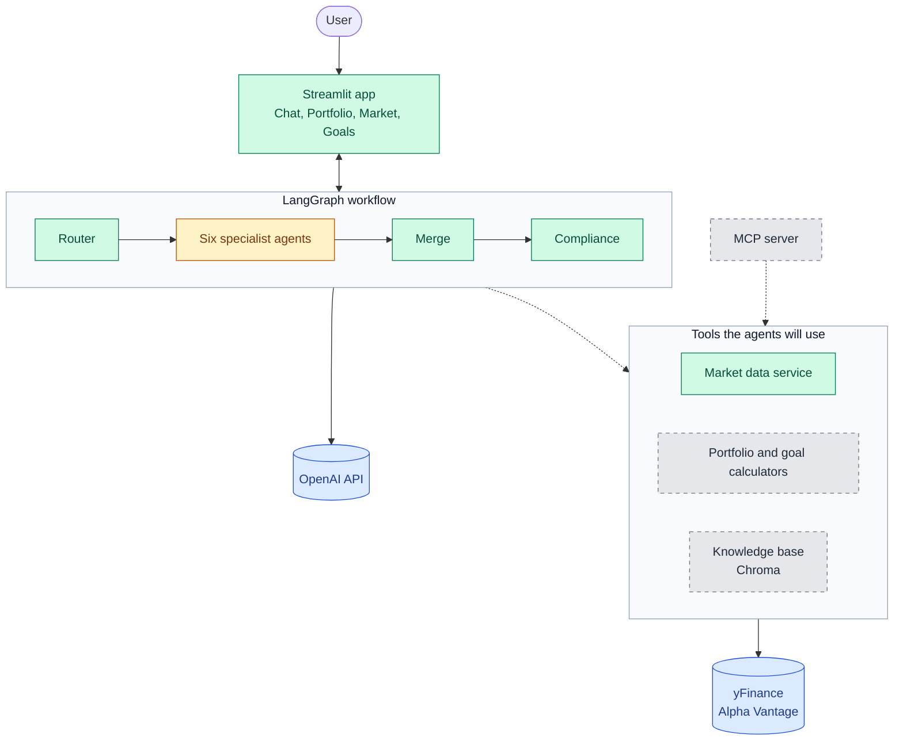
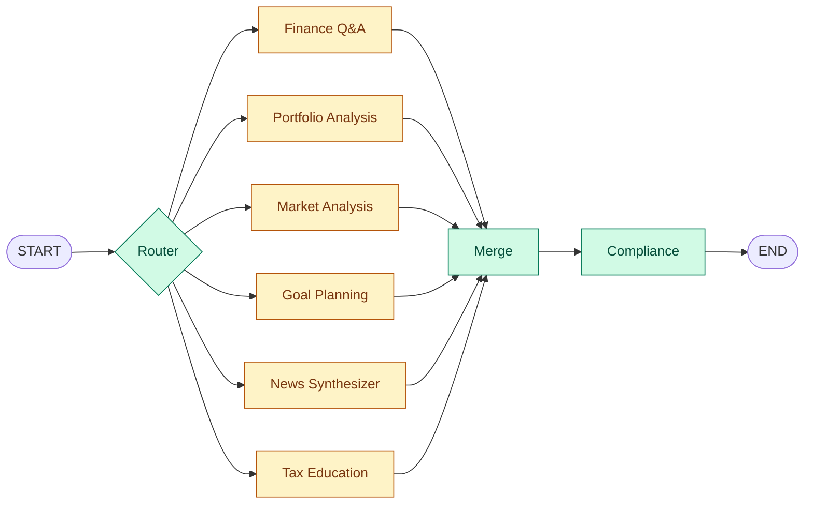
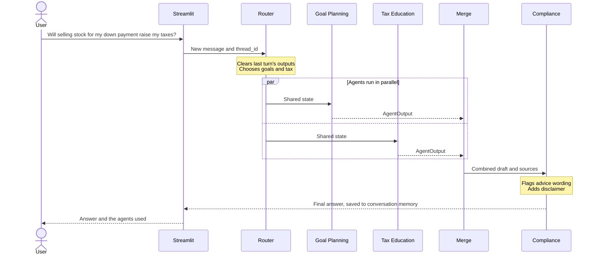
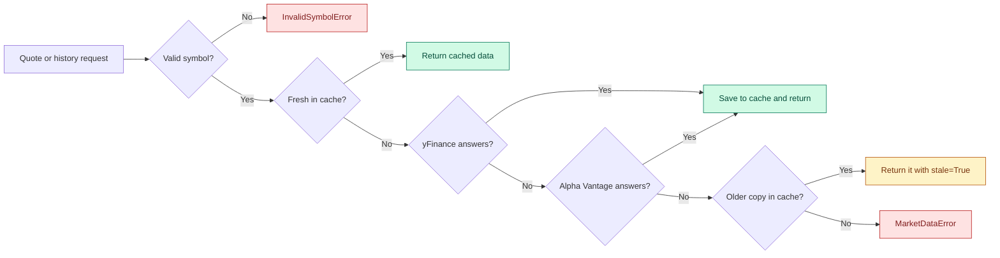
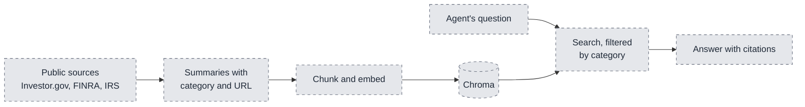

# Technical Design: AI Finance Assistant

Living document. It describes both what exists and what is planned, and the status below shows which is which.

## Scope
Education for US beginners, not personalized advice. Tax content covers US rules only.

## Build status
| Part | Status |
|---|---|
| LangGraph workflow, router, memory, compliance | Built |
| Market data layer | Built; Alpha Vantage tested only against simulated responses |
| Streamlit app | Chat works; dashboard tabs are placeholders |
| Six agents | Stubs that return placeholder text |
| Portfolio metrics, goal projections | Built and tested, not yet connected to agents or the UI |
| Knowledge base, MCP server | Planned |

## System overview

**Key:** green is built, yellow is a stub, gray is planned, and blue is an external service. Dashed arrows are connections that don't exist yet. Only the router calls OpenAI today, and only the market data service uses yFinance and Alpha Vantage.

## Stack
| Concern | Choice | Why |
|---|---|---|
| Orchestration and state | LangGraph | Named in the rubric; explicit graph, parallel branches, built-in memory |
| LLM | OpenAI, set in `config.yaml` | Key available; created in one file (`src/core/llm.py`) |
| Vector store | Chroma (planned) | Runs locally with metadata filtering for categories |
| Market data | yFinance, Alpha Vantage fallback | Free primary source plus a backup |
| UI | Streamlit | Named in the rubric; quick multi-tab app |

## Workflow
This graph matches `src/workflow/graph.py`. The router can select any combination of agents, and those agents run in parallel.

- **Router:** the LLM picks one or more agents using structured output. Keyword rules take over if there is no key or the call fails.
- **Agents:** each takes state and returns one `AgentOutput`.
- **Merge:** combines outputs in a fixed order and de-duplicates sources.
- **Compliance:** adds a disclaimer and flags advice-like wording.

## One question, start to finish
This example follows a question that spans two agents.

## Agent communication
Agents do not call each other. They communicate only through shared state (`src/core/state.py`), which keeps them independently testable. Results are combined by the `collect_outputs` reducer; the router clears it each turn so old answers do not leak into the next one.

## Key decisions
1. **Code calculates, the LLM explains.** Financial figures will come from tested Python, so the model cannot invent them. This is a design rule until the real agents are built.
2. **Failures stay contained.** A failing agent yields an error output, and other agents still answer.
3. **Conversation memory is per thread.** `InMemorySaver` keeps it for the life of the server process, which is enough for a demo but is lost on restart.
4. **Compliance is enforced by the graph,** so no agent can skip it.

## Market data

Quotes stay fresh for 60 seconds and history for an hour. A rate-limited provider is skipped for a cooldown period. The free Alpha Vantage series covers about 100 trading days, so long-range requests served by the fallback come back shorter.

## Portfolio metrics
`src/utils/portfolio_metrics.py` calculates value, weights, gains, effective number of holdings, volatility, max drawdown, Sharpe ratio, and beta against the S&P 500. Risk metrics apply today's weights to past daily returns, so they describe the current mix rather than the user's actual results. Returns are not annualized below 200 trading days. The metrics can't see inside funds, so a broad ETF counts as one holding and observations word concentration accordingly. Holdings' returns include dividends while the S&P 500 index does not, which slightly flatters comparisons against it. Observations state facts and never say what to do. Missing prices or history are reported, not hidden.

## Goal projections
`src/utils/goal_projections.py` gives a straight-line estimate and a seeded Monte Carlo simulation of monthly lognormal returns. Targets grow with inflation, and contributions stay flat. Return and volatility assumptions are illustrative values in `config.yaml`, and taxes and fees are ignored.

## RAG (planned)
50-100 summaries of public sources (Investor.gov, FINRA, IRS), each tagged with category and source URL, retrieved with category filters and cited in answers.

## Performance (planned)
Benchmarks for router accuracy, retrieval hit rate, and latency, from a labeled question set.
