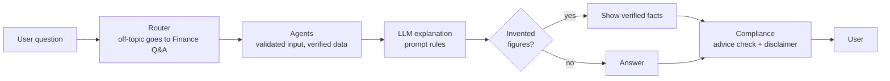

# Guardrails

This document lists every check that keeps the assistant accurate, educational, and safe, along with its known gaps. For how these are measured, see [METRICS.md](METRICS.md).

## Approach
- **Code beats prompts.** Evals showed the model can ignore prompt rules, and an LLM judge can miss it. Rules that must hold are enforced in code.
- **Code calculates, the LLM explains.** Financial figures come from tested Python, and the model only explains them.
- **Fail safe.** When a check fails or a service is down, the user gets verified facts or a clear refusal, never a guess.

## Output guardrails

| Guardrail | Enforced by | What it does | Where | Tests |
|---|---|---|---|---|
| Invented figure check | Code | Rejects an answer containing a dollar amount, percentage, or year that isn't in the source data or the question, and shows the verified facts instead | `explain` in `src/agents/common.py` | `test_explain_discards_answers_with_invented_figures`, `test_invented_years_are_caught` |
| Prediction refusal | Code | Adds "I can't predict what prices or markets will do" when a market question asks about the future | `src/agents/market.py` | `test_prediction_question_always_gets_the_refusal` |
| Summary without figures | Code | When several agents answer, the sentence linking their sections is dropped if it contains any figure | `make_merge_node` in `src/workflow/graph.py` | `test_merge_drops_a_link_containing_figures` |
| Advice wording check | Code (regex) | Flags "you should buy, sell, or invest in", "I recommend buying or selling", and "guaranteed returns" or "risk-free profit", then adds a note that the answer is educational | `src/workflow/compliance.py` | `tests/test_compliance.py` |
| Disclaimer | Code | Adds the "not personalized advice" disclaimer to every answer. The compliance step is part of the graph, so no agent can skip it | `compliance_node` | `test_education_passes_with_disclaimer_only` |
| Knowledge base cutoff | Code | Declines with "I couldn't find this in my verified knowledge base, so I won't guess" when no article scores at least 0.3 | `src/agents/knowledge.py`, `src/rag/store.py` | `test_knowledge_refuses_to_guess_without_results`, `test_weak_matches_are_dropped` |
| Close matches only | Code | Uses and cites only articles within 0.1 of the best match, so a weak match isn't used | `src/agents/knowledge.py` | `test_weak_matches_are_not_used_or_cited` |
| Source citations | Code | Shows the articles, market data provider, or news links behind each answer | Agents, merge step, and chat UI | `test_knowledge_answer_cites_sources` |
| Stale data label | Code | Marks a price as "may be out of date" when it comes from an old cached value | `src/agents/market.py` | `test_market_marks_stale_prices` |
| News relevance filter | Code | Drops headlines that don't mention the company or topic | `is_relevant` in `src/data/news.py` | `test_is_relevant` |
| Fallback to facts | Code | Shows the calculated facts if the explanation call fails | `explain` | `test_explain_shows_facts_when_llm_fails` |
| Answer rules | Prompt only | Use only the provided facts, copy figures exactly, no buy, sell, or hold advice, no predictions, and stay under 180 words | `RULES` in `src/agents/common.py` | `test_explain_prompt_carries_rules_level_and_facts` |

## Input-side protections
The app has no dedicated input guardrails. Nothing screens or limits a question before it reaches the model. These checks reduce risk from user input:

| Protection | What it does | Limit |
|---|---|---|
| Off-topic routing | Unrelated questions go to Finance Q&A, which declines them | Relies on the model's routing choice and the knowledge base cutoff |
| Router output validation | The router can only return valid agent names; if it fails, keyword rules take over | Keyword rules are less accurate |
| Structured extraction | Holdings, goals, and symbols must fit a fixed schema before any calculation, and invalid values are explained to the user | Checks the format, not whether values are sensible |
| Symbol validation | Ticker symbols must match a valid pattern before lookup, and each question is capped at 5 | Doesn't confirm the company exists until the lookup |
| Login | Only signed-in users can ask questions | Doesn't check the content of questions |

## Untrusted data
Retrieved articles, market data, and news come from outside the app, so they are treated as data:

| Protection | What it does | Where |
|---|---|---|
| Injection rule | Tells the model that the facts are data and to ignore any instructions in them | `RULES` (prompt only) |
| Approved sources | Knowledge base indexing fails if an article has no source on Investor.gov, FINRA, or IRS.gov | `src/rag/articles.py` |
| Safe news links | Accepts only `https` links, so a link like `javascript:` can't become clickable | `_parse` in `src/data/news.py` |
| XML attack protection | Rejects news feeds containing a document type declaration | `parse_feed` in `src/data/news.py` |
| Figure check | Limits the damage of an injection, since any number not in the facts is rejected | `explain` |

## Account and data protections
| Protection | What it does |
|---|---|
| Password hashing | Passwords are stored only as salted `scrypt` hashes |
| Login errors | Wrong passwords and unknown emails get the same message and take the same time |
| Conversation ownership | Every conversation query filters by user, so knowing a conversation ID grants nothing |
| Logout | Clears the whole session, so nothing carries over to the next user |
| Database permissions | The SQLite file is readable only by its owner and excluded from Git |
| Tracing user ID | Arize receives a random user ID, not the email |
| Secrets | API keys live only in `.env`, which Git ignores |

## Known gaps
| Gap | Risk | Suggested fix |
|---|---|---|
| No input length limit | Long questions raise cost and make prompt injection easier | Reject questions over a set length |
| No content moderation | Abusive or harmful text isn't screened | OpenAI's free Moderation API |
| No prompt injection detection | Only prompt rules and the figure check resist "ignore your rules" | A classifier or a moderation check |
| No personal data filter | Account or Social Security numbers would reach OpenAI and Arize | A pattern check; the sign-up screen warns users meanwhile |
| Narrow advice check | The regex catches only a few phrasings, so "this is a great time to get into Tesla" would pass | An LLM classifier on final answers, or more patterns |
| Wording isn't checked | The figure check catches invented numbers, not invented claims or mild judgments | LLM judge evals and Arize online evals |
| False positives | The advice check can flag a scam warning that quotes "guaranteed returns" | Review flagged answers in traces |
| No login rate limit | Passwords can be guessed repeatedly | Lock out after repeated failures |

## MCP server
`ask_finance_assistant` runs the full workflow, so every guardrail above applies. The other tools return data for the client's own model to explain, so they skip the figure check, advice check, and prediction refusal.

| Protection | What it does |
|---|---|
| Server instructions | Ask the client to treat results as education, not advice or predictions |
| Disclaimer field | Portfolio and goal results include the "not personalized advice" note |
| Input limits | Questions up to 2,000 characters, up to 10 symbols, and up to 50 holdings |
| Validated input | Symbols, holdings, and goal values use the same checks as the app |
| Cutoff and sources | Knowledge base search keeps the 0.3 cutoff and returns each source link |
| No account access | The server reads no saved users, holdings, or conversations |

The client's model can still give advice in its own words, and nothing on the server can stop that.

## How guardrails are verified
- **Unit tests** cover each code guardrail, as listed above.
- **Agent evals** (`python -m src.workflow.evaluate`) measure advice safety, prediction refusals, out-of-scope declines, and faithfulness. See [EVAL_RESULTS.md](EVAL_RESULTS.md).
- **Arize traces** record `answer_rejected` and `compliance_flagged` events, so you can see how often guardrails act on real questions.

The eval questions were written by the project author, so their scores are likely optimistic.
